<div align="center">

# VEYLATTICE

**An original tactical elemental card battler for the browser.**

Grid movement · persistent Guard · five-element counter-cycle · a tactical AI that plays by the rules

[](https://xiondigital.net/veylattice/)
[](#tests)
[](#architecture)
[](LICENSE)

</div>

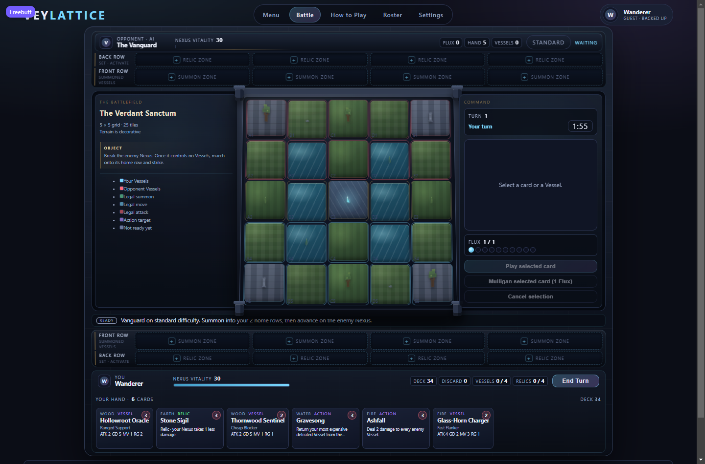

---

## ▸ What this is

Veylattice is a tactical collectible card game: you deploy **Vessels** onto a 5×5 lattice, manoeuvre
them into firing lanes, and break the opposing **Nexus** before yours falls. Every unit is a
miniature sculpture of its element, every trade is decided by persistent Guard, and the five-element
cycle decides who hits harder.

This repository is a **working vertical slice**, not a design document. A deterministic rules engine
with typed Action and Relic cards, a tactically competent AI opponent, portable accounts with a
cross-device recovery code, animated voxel combat, and automated tests all ship from this tree today.

| Playable now | Not built yet |
|---|---|
| Main menu, How to Play, guided first match — no auto-launch into a game | Deck builder, shop, packs, ownership |
| 5×5 board (25 tiles) with tinted deployment zones and one contested row | Online lobbies and server-authoritative matches |
| Integrated war table: 4 Vessel + 4 Action/Relic zones per seat, built into the arena | — |
| Persistent Guard, simultaneous retaliation, lethal trades | Lore Bonds, arenas, Forge, Codex |
| Five-element counter-cycle (advantage ×1.5, resistance ×0.5) | Ranked ladder and seasonal rewards |
| **30 Action cards** (damage, sweep, drain, stun, ready, revive, draw, heal, buff, Nexus, Flux) | Google / Discord sign-in (needs OAuth credentials) |
| **12 Relic cards** in four back-row zones (the Relic cap and the field agree) | Setting Actions face-down (Actions resolve from hand) |
| **65 Vessels** with three closed keywords: `swift`, `stalwart`, `deathrattleDraw` | — |
| Typed, data-only effects — no card can carry code | Terrain that changes rules rather than decoration |
| Flux economy 1→10, one summon, four-Vessel cap | — |
| 120-second deadline with automatic turn pass | — |
| Tactical AI: 4 difficulties × 3 styles, plays Actions and Relics | — |
| **65 individually modelled 3D Vessels** (2,890 boxes) in a CSS-3D renderer | — |
| **107 printed card faces** in a browsable Card Library | — |
| Combat: lunges, impact, floating damage, Guard ticks, deaths | — |
| Contextual prompts, cancel/Escape, legality reasons | — |
| Profiles, avatars, match record, **portable accounts** | — |
| **129 automated tests** + offline-first play | — |

> **Honest status:** Seat 2 is a real AI opponent with no access to your hand. The game opens on a
> menu; nothing starts until you press a button. Every Vessel on the board is its own voxel model —
> there is no generic fallback in the shipped roster, and a missing model renders a labelled
> placeholder instead of a silent cube.

---

## ▸ The printed set: 107 finished cards

Every card in the game is also a designed object. `Cards/` holds one 1086×2048 face per card — the
attached reference card's 543:1024 proportion — and the game's **Cards** tab is that folder, with
category and element filters and a full-size viewer reachable from the library, the roster and the hand.

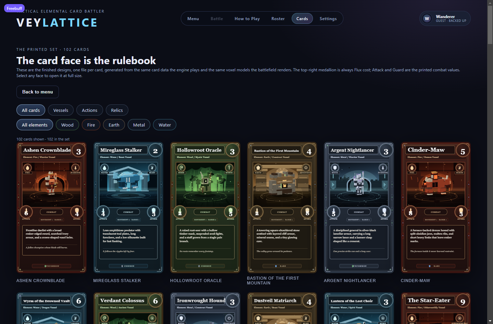

One hierarchy on every face: name, Flux medallion top-right, attribute line, element and subtype
emblems, a 902×700 illustration window, Attack and Guard medallions, rules in upright type, then
flavour in italic. Actions and Relics print an `ACTION` / `RELIC` band and **no** stat sockets — they
are not units with missing numbers.

### Each Vessel is staged in its element's place

The illustration is not a separate drawing. It is that Vessel's own voxel model, projected through a
three-quarter camera, shaded per material, painter-sorted, and placed in an environment built from its
element: a **fortress gatehouse** for Metal, a **rootbound grove** for Wood, a **drowned temple** for
Water, a **furnace hall** for Fire, a **canyon gate** for Earth. All five share one value structure —
bright sky, dark far silhouettes, mid-tone side masses, a lit opening directly behind the figure, fog
at the ground line, near-black rubble in front — which is what makes the set read as one game.

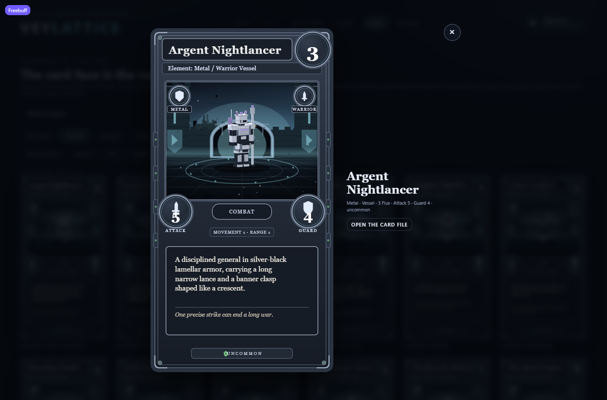

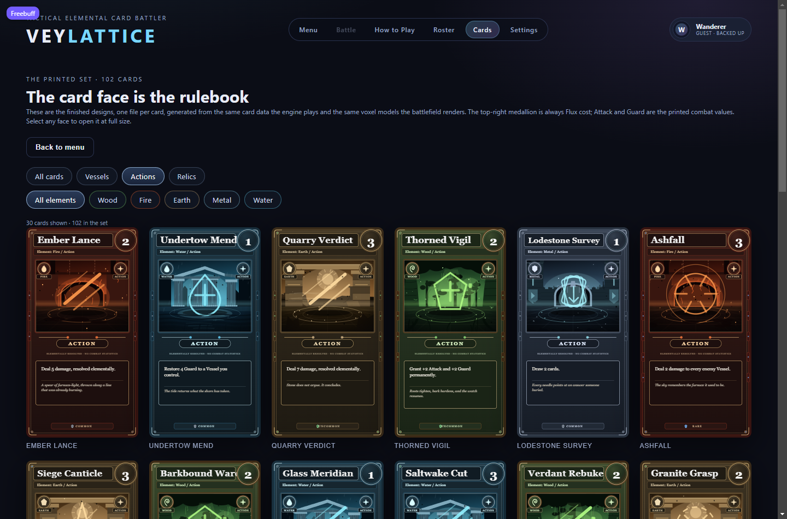

Add a weapon to a Vessel's model and its card art gains it; there is no second asset to drift.

### The human knights

Every element now fields an armoured human, not only monsters and spirits. Earth's **Oathstone
Knight** braces behind a paved shield, Metal's **Ironvow Paladin** carries a great axe and a plume,
Water's **Tidewall Sentinel** holds a causeway with a tide spear, Fire's **Cinderwatch Knight** walks
her post with a brazier, and Wood's **Thornmarch Ranger** scouts with a longbow. They are built on the
humanoid rig but read apart from each other by equipment and mass: the knight's helm and shield, the
ranger's hood and bow, the paladin's long cloak and back-swept plume.

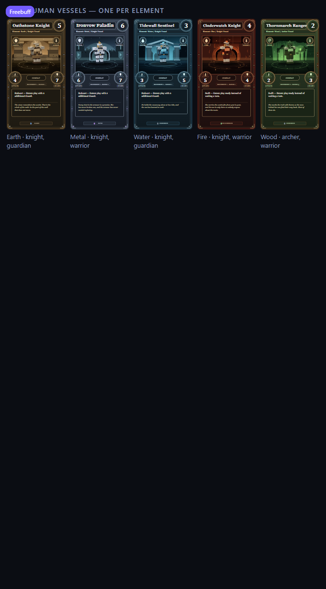

### Rebuild them

```bash
node tools/build-cards.mjs      # 107 faces, art layers, frames, manifest, QA sheet, contact sheet
npm test                        # fails if a face on disk is stale
```

The build writes `Cards/cards/<id>.svg`, `Cards/art/<id>.svg`, reusable `Cards/frames/`, a
machine-readable `Cards/manifest.json` and `Cards/QA.md`. `tests/card-files.test.js` re-renders every
face and compares it byte for byte, so a data edit cannot leave a card printing the old numbers.

---

## ▸ The menu, the tutorial and the roster

<div align="center">

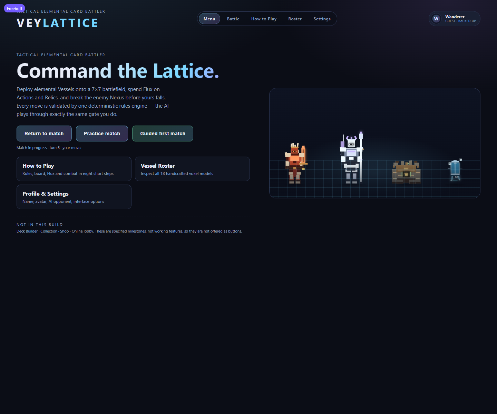

</div>

The app no longer drops you into a match. The menu offers **Practice match**, **Guided first match**,
and — only while a game is genuinely in progress — **Return to match**. Deck Builder, Collection, Shop
and Online are listed as *not in this build* rather than shown as buttons that do nothing.

On a first visit the **How to Play** page opens by itself: eight short steps covering the objective,
what a Vessel is, where you may summon, Actions and Relics, movement and combat, Flux, ending a turn,
and how a Nexus actually dies. It stays reachable from the header forever, and completion is stored
locally — practice never requires an account.

<div align="center">

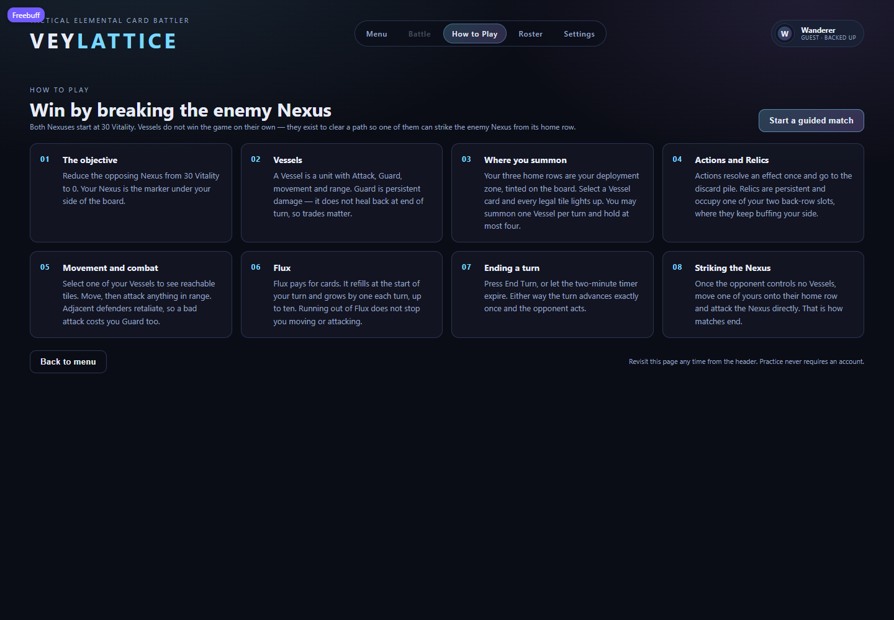

</div>

**The guided match is the real game.** It does not script a board. It watches the events the engine
emits (`summon`, `move`, `attack`, `turnEnd`…) and advances a five-step checklist over a live practice
match, with a state-aware nudge when a step cannot be completed yet — for example *"No Vessel in hand
can be summoned right now — end the turn to keep going."* Ending the turn always advances a step, so
the tutorial can never trap you, and Skip is always one click away.

<div align="center">

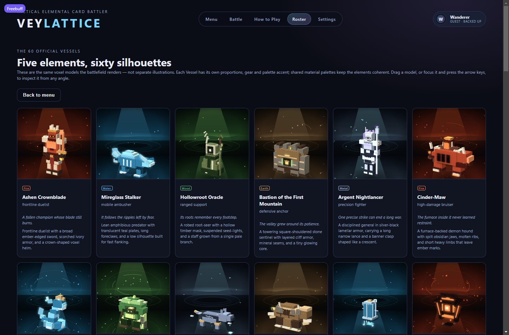

</div>

**The Roster page renders the same model files the battlefield uses**, and the scene behind each model
is that Vessel's generated card art with the figure removed — one definition, two presentations. All 65
official Vessels have their own voxel definition: 30–60 boxes each, distinct silhouettes, grouped for
animation, and a per-model palette blended from its element. Eighteen are hand-placed rigs; the
expansion's forty-seven use five shared anatomical blueprints (humanoid, quadruped, construct, drake,
spirit) with separate body plans for robed casters, split-tabard spellblades, tabard-less knights and
lean predators, and every one supplies its own proportions, head, weapon, offhand, crest, cape and
palette keys.

Actions and Relics are illustrated from their effect kind, so the art says what the card does — here a
draw Action's fan-and-arrow emblem in a metal scene:

<div align="center">

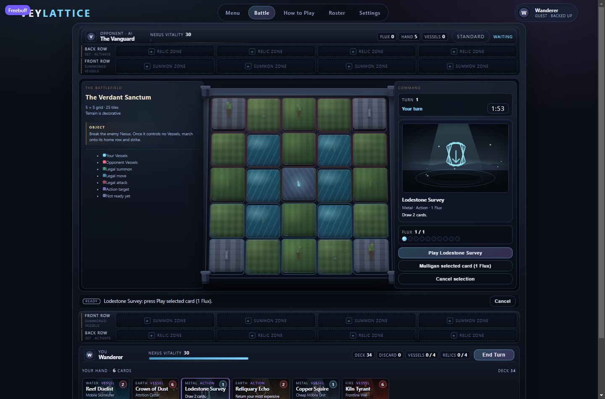

</div>

Practice deals a **fresh seeded 40-card selection from the 65-Vessel pool** on every match — 20
Vessels (four per element), eight Actions at two copies, four Relics — so the whole roster can reach
the board before a deck builder exists. The generated deck is always checked against the canonical
deck rules.

---

## ▸ Where to play

| Surface | URL | Status |
|---|---|---|
| Custom domain | **https://xiondigital.net/veylattice/** | GitHub Pages project site under the existing `xiondigital.net` custom domain — no DNS changes, base site untouched |
| GitHub Pages | https://xiondigital.github.io/veylattice/ | Same build, account subdomain |
| Local | `python -m http.server 8000` → `http://localhost:8000` | Always works offline |

The app is a static bundle with **no build step and no runtime dependencies**. It also runs from
`file://`-adjacent hosts, but ES modules require HTTP — use the local server command above.

---

## ▸ The AI opponent

The AI is the centrepiece of this milestone, so it is built around three testable guarantees rather
than "it feels smart".

### Guarantee 1 — it cannot cheat

```
buildObservation(state, seat)  →  own hand + public board + opponent *counts* only
buildCandidates(state, seat)   →  commands produced by the engine's own getLegalActions()
choosePlan(candidates, obs)    →  pure scoring; receives no match state at all
applyCommand(state, command)   →  the same validator the human uses
```

- **No hidden information.** The opponent's hand and deck are exposed to the decision function as
  counts, never contents. A test mutates the opponent's hand and asserts the chosen command is
  byte-identical.
- **No bypass.** Every candidate is an engine command; a rejected command leaves state untouched and
  is surfaced in the match log. An AI-versus-AI match test asserts zero rejections across a full game.
- **No cheating on resources.** Difficulty changes *decision quality* (search window, noise, trade
  modelling, threat awareness) — never stats, Flux or extra actions.

### Guarantee 2 — it is bounded

Each decision checks an injected clock against a per-difficulty budget and keeps the best plan found
so far. Budgets are 8 / 20 / 45 / 120 ms. A test forces the budget to bite and asserts the AI still
returns a legal plan with `truncated: true`.

### Guarantee 3 — difficulty is real

| Difficulty | Budget | Search | Trade model | Threat model | Finds move-then-strike |
|---|---|---|---|---|---|
| Novice | 8 ms | 90 candidates, 5-way random pick | 25 % retaliation awareness | none | no |
| Standard | 20 ms | 400 candidates | 85 % | 35 % | yes |
| Veteran | 45 ms | 900 candidates | full | 80 % | yes |
| Master | 120 ms | 1800 candidates | full | full | yes + enemy best-response penalty |

Three personalities change the weights, not the rules:

| Style | Bias | Behaviour |
|---|---|---|
| **The Vanguard** | +30 % aggression, +30 % Nexus focus | Advances and races your Nexus |
| **The Warden** | +40 % defence, +35 % survival | Attrites, refuses bad trades, punishes overextension |
| **The Conductor** | +35 % positioning, +35 % element play | Hunts elemental advantages and firing lanes |

A crafted-position test proves the tiers differ for a reason: a Veteran sees the lethal
move-onto-home-row-then-strike line and wins the match; a Novice has no move-then-attack search and
cannot. A separate test proves the Veteran rates a suicidal trade *below* the Novice and declines it.

The AI also plays the new card types through the same command path: `buildCandidates` enumerates
`playAction` and `playRelic` plans from `getLegalActions`, and `evaluateAction` scores damage (with
retaliation modelled as zero), kills, sweeps, heals, buffs, draws and Nexus burn. It is never offered
a cast that would do nothing — a board wipe against an empty board and a heal on an undamaged Vessel
both return no plan at all, which was caught in browser play and fixed at the scoring level.

---

## ▸ Actions, Relics and voxel combat


Cards are **typed data, never code**. Every effect is one of a closed set of `kind` values, validated
against a numeric range, frozen at catalog build time, and executed by one switch in the engine. A
card that tries to smuggle behaviour is rejected before a match can start.

| Card | Element | Cost | Effect |
|---|---|---|---|
| Ember Lance | Fire | 2 | 5 damage to a Vessel, resolved elementally |
| Quarry Verdict | Earth | 3 | 7 damage to a Vessel |
| Ashfall | Fire | 3 | 2 damage to every enemy Vessel |
| Siege Canticle | Earth | 3 | 4 damage to the enemy Nexus |
| Undertow Mend | Water | 1 | Restore 4 Guard, capped at maximum |
| Thorned Vigil | Wood | 2 | Permanent +2 Attack / +2 Guard |
| Barkbound Ward | Wood | 2 | Permanent +4 Guard |
| Lodestone Survey | Metal | 1 | Draw 2 |
| Ember Lens | Fire | 2 | Relic · your Vessel attacks deal +1 |
| Stone Sigil | Earth | 3 | Relic · your Nexus takes 1 less |
| Choir Bell | Water | 2 | Relic · mend 2 Guard at the start of your turn |
| Verdant Seal | Wood | 3 | Relic · your Vessels have +2 Guard |

Relics are persistent, capped at four per seat (one per back-row zone), and their auras are computed in one place
(`relicAuras`) so the HUD, the previews, the engine and the AI cannot disagree. A Guard aura applies
to Vessels already on the table *and* to every future summon, so the bonus does not depend on timing.

### The 3D Vessels

There are no GLB files and no Three.js dependency: the renderer is **CSS 3D**, in
[`src/render/voxel.js`](src/render/voxel.js). Each box becomes a node with three visible faces
(front, right, top) inside a `preserve-3d` scene, scaled by one CSS variable — the same markup is a
43 px tile on a phone and 170 px in the roster. It downloads nothing and works on the static host.

Models are **data**, split by element under [`src/render/vessels/`](src/render/vessels): a list of
boxes in voxel units with an animation group (`body`, `head`, `weapon`, `armL/R`, `tail`, `cloak`…),
size, offset, colour key, **material** and optional rotation. The renderer is handed a card id; it
cannot change a match.

**2,388 boxes across the 60 official Vessels** (30–59 each), and every one of them is individually
authored against [`docs/UNIT_VISUAL_DESIGNS.md`](docs/UNIT_VISUAL_DESIGNS.md).

- **Materials, not tints.** Each palette defines a whole material world per element — ceramic, cloth,
  leather, bark, stone, brass, bone, crystal, glass, void — and each material shades its three faces
  differently (steel gets a hard top and a dark side; cloth stays matte). Depth survives greyscale.
- **Articulated groups.** Boxes are grouped around authored pivots, so an attack swings the weapon
  around the wrist, snaps the head around the neck and lashes the tail — not just a whole-body tilt.
- **Angled geometry.** Fins, banners, lances, antlers and blade snouts are rotated boxes, so
  silhouettes are not all axis-aligned stacks.
- **Idle languages.** `breathe`, `heavy` (deliberate, slow), `sway` (serpentine), `hover` (floating)
  and `none`, chosen per unit rather than stamped on the roster.

| Element | Material language |
|---|---|
| Wood | carved bark bands, root joints, leaf fins, cream fungus |
| Fire | blackened ceramic, ember seams, scorched bronze, upward spires |
| Earth | sandstone strata, slate plates, mineral seams, wedge feet |
| Metal | brushed plates, hinges, rivets, bright rims, brass inlays |
| Water | aqua glass, wet shell, pearl bone, ribbon fins, suspended shards |

Subtype drives the silhouette too: Beasts are quadrupeds with low centres of mass, Constructs are
jointed and blocky, Dragons are long and serpentine, Spirits float with no legs, and Otherworldly
Vessels break anatomy outright (the Star-Eater is a hovering eclipse core inside disconnected rings).

A test enforces the roster: every official Vessel has a model, no two models share a silhouette, every
box uses a real palette key and material, every model has 30+ boxes across 4+ animation groups and 4+
materials, and a missing id returns `null` rather than a silent cube.

### The war table: one battlefield, eight zones per seat

The battle screen is one object, not a board with panels bolted around it. From top to bottom:

1. opponent identity, Nexus vitality (the bar itself is the strike target), Flux, hand and Vessel counts;
2. the opponent's **four back-row Action zones**;
3. the opponent's **four front-row Vessel zones**;
4. the 5×5 voxel diorama, with the player's deployment rows tinted;
5. the player's four front-row Vessel zones, then four back-row Action zones;
6. the player console (identity, Nexus vitality, deck/discard, counts, End Turn) and the hand.

Every zone is built from match state, never from the DOM: [`src/ui/fields.js`](src/ui/fields.js)
projects four Vessel slots and four Relic slots per seat, and stamps each one with a stable key
(`seat0:vessel:2`). The engine assigns a Vessel its zone at summon time, so a unit keeps its place when
another dies and the next summon fills the gap. The four Relic zones are also the rule: the per-seat
Relic cap is four, so the interface cannot promise capacity the engine rejects.

**How the zones connect to play**

| Interaction | Result |
|---|---|
| Click a Vessel card in hand | all four front-row zones light up, and the ten legal deployment tiles ring on the grid |
| Click a highlighted tile | the engine resolves the summon, the card leaves the hand, Flux drops and the Vessel appears in the next free front-row zone |
| Click a filled Vessel zone | that unit is selected; reachable tiles and legal attacks highlight on the board |
| Click a Relic card, then the next free Action zone | the Relic is set through the engine and occupies that socket |
| Click a filled Action zone | its effect is read back to you; no hidden card data is invented |
| Click a wrong/early Action zone | nothing mutates, and the status line explains which socket is next |

Actions resolve from hand and go to the discard pile, so they never sit in a back-row zone; that is
the canonical rule, not an omission. Empty zones read as carved sockets, occupied ones carry the real
model, live Guard and stats, and the player's field also mirrors the engine's `Vessels 0/4` and
`Relics 0/4` counters.

### The arena

The board is still the authoritative 5×5 grid, dressed as a miniature arena on a plinth: layered
ground blocks with real thickness, carved seams, back-edge props, a deterministic per-tile tone shift
so neighbouring tiles stop repeating, a key light from the upper left and a vignette at the edge.
The Arena shell frames it with the arena name, objective, interaction key and a command console. The
5×5 hit targets, coordinates, deployment tints and legal-summon rings sit above the scenery and are
unchanged.

[`src/render/terrain.js`](src/render/terrain.js) owns the ground map and props. It is **decorative by
contract**: every kind declares `rules: "decorative"`, the layout is point-symmetric so neither seat
gets a prettier side, and a test asserts the rules engine and AI never import it. Water tiles are
shallow, walkable and labelled as decoration under the arena name — the UI does not promise a
mechanic the engine lacks.

> **Balance note, not a bug:** the canonical Flux curve gives 1 Flux on your first turn and the
> cheapest Vessel costs 2, so turns one and two are spent on cheap Actions, a mulligan or passing.
> The tutorial says so explicitly. Changing that is a balance decision for `GAME_RULES.md`, not a UI
> tweak.

### Combat presentation

Attack resolution is animated from the engine's own events, never from re-derived state:

- the attacker **lunges** toward its target using a per-strike offset, then settles;
- the defender **flashes and shakes**, and a floating `-N` rises from the tile (larger and amber on an
  elemental advantage, smaller and red for retaliation);
- surviving Guard **counts down** from its old value to its new one instead of snapping;
- a lethal hit leaves a **ghost chip that crumbles** away before the tile clears;
- Nexus strikes **shake the board** and stamp a large number on the Nexus;
- Actions add violet impact rings, green mend pulses and gold buff glows.

Everything is skipped when `prefers-reduced-motion` is set or the in-game toggle is on, and no effect
can mutate a match — the presentation layer only reads events.

---

## ▸ Rules at a glance

| Rule | Value |
|---|---|
| Board | 5×5 (25 tiles), two deployment rows per seat, orthogonal movement, occupied cells block paths |
| Vitality | 30 per Nexus |
| Flux | Starts at 1, +1 per turn, caps at 10, refills each turn |
| Opening | 5 cards, mandatory draw at turn start, fatigue escalates |
| Summons | One per turn, max four Vessels, own three deployment rows, enters unready |
| Card fields | Four Vessel zones and four Action/Relic zones per seat, mirrored top and bottom |
| Relics | Max four per seat, one per back-row zone; Actions resolve from hand |
| Actions per Vessel | One move **and** one attack per ready Vessel |
| Guard | Persistent durability; printed maximum is preserved separately |
| Retaliation | Simultaneous, if the defender's range and line of sight allow it |
| Nexus | Strikable only from the enemy home row **and** only while the opponent controls no Vessels |
| Element cycle | Wood → Earth → Water → Fire → Metal → Wood |
| Element maths | Advantage `floor(1.5 × Attack)`; resistance `max(1, floor(0.5 × Attack))`; applied per packet from current Attack |
| Mulligan | Once per turn, 1 Flux, bottom one card and draw one |
| Turn clock | 120 seconds, engine-resolved; a late command is rejected and the turn passes without duplicating accepted actions |

Elemental maths lives in exactly one module ([`src/game/elemental-rules.js`](src/game/elemental-rules.js))
and is tested across all 25 pairs. The old halved-Guard proposal was withdrawn rather than silently
reinterpreted — see [docs/ELEMENTAL_SYSTEM.md](docs/ELEMENTAL_SYSTEM.md).

---

## ▸ Profiles, avatars and stored data

<div align="center">

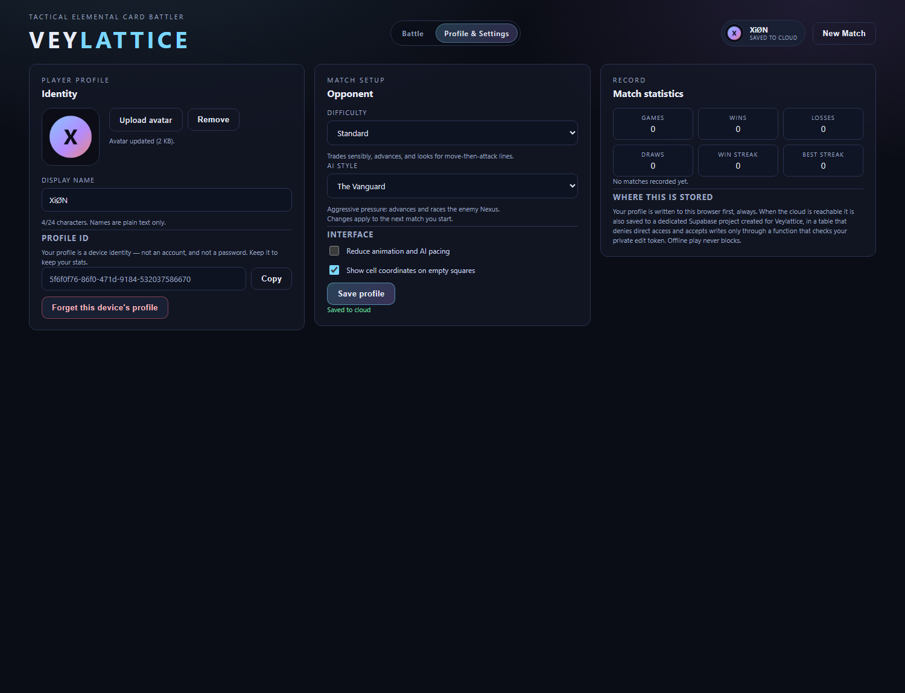

</div>

The **Profile & Settings** tab holds your display name, avatar, opponent configuration, motion and
coordinate preferences, and your match record.

**Avatar upload** is a real pipeline, not a form field: pick a PNG/JPEG/WebP, the browser centre-crops
it, resizes to 128 px, and compresses to WebP (falling back to smaller sizes and JPEG if needed). A
512 px / 132 KB source lands as a **2.4 KB** stored image. SVG is rejected — it can carry active
content. Removal is one click.

### Where the data actually goes

| Layer | What | Behaviour |
|---|---|---|
| `localStorage` | Whole profile + guest edit token (and the account link, once signed in) | Written first, always. The game never blocks on the network. |
| Supabase Postgres | Name, avatar, settings, stats — under a device row *or* an account | Best-effort sync; the UI reports *Saved to account*, *Saved to cloud*, *Saving…* or *Offline — saved on this device*, never a success it did not observe |

The cloud side runs in a **dedicated Supabase project created for Veylattice**, deliberately separate
from the Sohbet project so nothing here can touch another app's data or quotas.

### Accounts, and why they exist

A guest profile is an identity bound to one browser: its credential is a token in `localStorage`, so
clearing site data breaks the link to the cloud row. **An account fixes exactly that.**

1. **Create account** uploads the current name, avatar, settings and record, and the server returns a
   **recovery code** — 20 characters from a 32-symbol alphabet (`XXXX-XXXX-XXXX-XXXX-XXXX`, 100 bits).
2. **Sign in** with that code on any device and the account's record replaces the local one.
3. **Sign out** returns this browser to a guest profile without touching the account.
4. **Issue a new code** invalidates the old one immediately.

No email, password, or personal data is collected. The code is the credential; the account id is only
a lookup key.

### Security model

```sql
-- RLS on, no anon table privileges: direct PostgREST access returns 401
revoke all on table public.veylattice_profiles  from anon, authenticated;
revoke all on table public.veylattice_accounts  from anon, authenticated;

-- Guest rows: guarded by a per-browser edit token
veylattice_profile_save(p_id, p_token, ...)   veylattice_profile_get(p_id)

-- Accounts: guarded by the recovery code
veylattice_account_create(...) -> {account_id, recovery_code}
veylattice_account_load(p_code)
veylattice_account_save(p_account_id, p_code, ...)
veylattice_account_rotate(p_account_id, p_code) -> {recovery_code}
```

| Threat | Mitigation | Verified |
|---|---|---|
| Client writes arbitrary rows | No table grants; RPC only | direct `GET /rest/v1/veylattice_accounts` → **401** |
| Hijacking someone's profile | 64-hex edit token; DB stores a bcrypt hash | wrong token → **401 `not authorized`** |
| Guessing an account code | 100-bit CSPRNG code; only a SHA-256 digest is stored | wrong code → `null`; wrong code on save → **401** |
| Reusing a revoked code | Rotate replaces the digest in one statement | old code → `null` after rotation |
| Stored XSS via avatar | DB `CHECK` allows only base64 PNG/JPEG/WebP data URLs | schema constraint |
| Oversized payloads | Name ≤ 24 chars, avatar ≤ 70 000 chars, JSON ≤ 4 000 / 2 000 chars | schema constraints |
| Tampered local storage | Every restored field re-sanitised (`sanitizeProfile`) | unit tests |
| Privileged key leakage | Only the publishable anon key ships; the service-role key is absent from the repo and browser | [config.js](src/net/config.js) |

**Verified end to end against the live database** — create → load → save with a wrong code (401) →
save with the right code → rotate → old code rejected → new code returns the updated record. Then,
in the browser: create an account, rename to *Lattice Adept*, sign out, rename the guest to *Guest
Only*, sign back in with the code, and see *Lattice Adept* return from the database. Test rows were
removed afterwards.

### Google and Discord

Supabase Auth is present on the project but **Google and Discord providers are disabled**, and turning
them on needs OAuth client credentials created in the Google Cloud and Discord developer consoles.
That is not something this build can do for you, so the UI says so instead of showing buttons that
cannot work. [docs/ACCOUNTS.md](docs/ACCOUNTS.md) lists the exact steps; the recovery code already
provides cross-device identity without them.

Reproduce the schema with [`supabase/migrations/0001_profiles.sql`](supabase/migrations/0001_profiles.sql)
and [`supabase/migrations/0002_accounts.sql`](supabase/migrations/0002_accounts.sql).

---

## ▸ Card art: one definition, two presentations

Every card in the game now carries a full-bleed illustration. The important part is *how* it is made.

`src/render/illustration.js` projects the card's canonical voxel model through a three-quarter camera,
shades each face against a key light, sorts the faces back-to-front, and places the figure in an
element-specific environment: layered ridges, horizon haze, an engraved summoning ring, a shaft of
stage light, floating motes, rarity arcs and a vignette. Actions and Relics get emblem scenes keyed to
their effect kind — a damage slash, a heal bloom, a draw fan — so their art states what the card does.

| Layer | Source |
|---|---|
| Figure | the same `VOXEL_MODELS` entry the battlefield renders, shaded from that model's palette |
| Environment | element scene (fire/water/earth/metal/wood), seeded per card so it never reshuffles |
| Rarity treatment | arcs and motes scale with common → mythic |
| Emblem (Actions, Relics) | effect kind, in the card's element colours |

Because the art is *derived*, it cannot drift from the playable model. Add a weapon to a Vessel and its
card art gains it. `tests/illustration.test.js` enforces that: it checks every card produces SVG, that
each Vessel's art is a projection of its model (palette, part count, declared voxel height), that no
figure is clipped by the frame, that two Vessels never share identical art, and that Action emblems
differ by effect.

<div align="center">

**A Vessel card**: the Ashen Crownblade's illustration is its battlefield model, lit and staged.

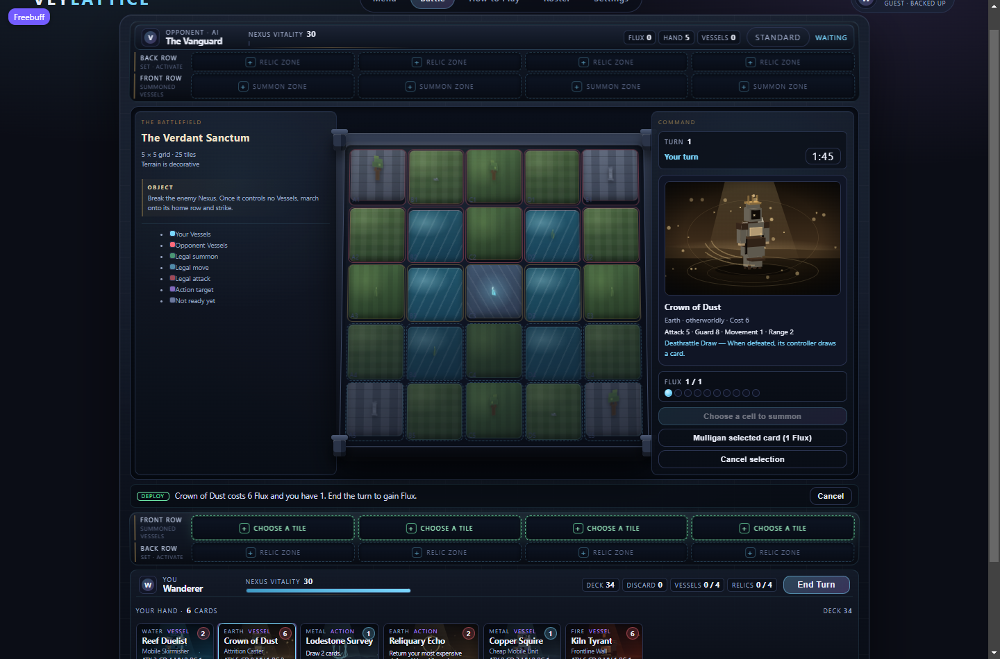

**The roster** shows the same scene behind a live, draggable model — no painted duplicate.


</div>

The hand rail uses the art as a dimmed full-bleed backdrop under the card's text, so a 138×84 card still
reads at a glance:

<div align="center">

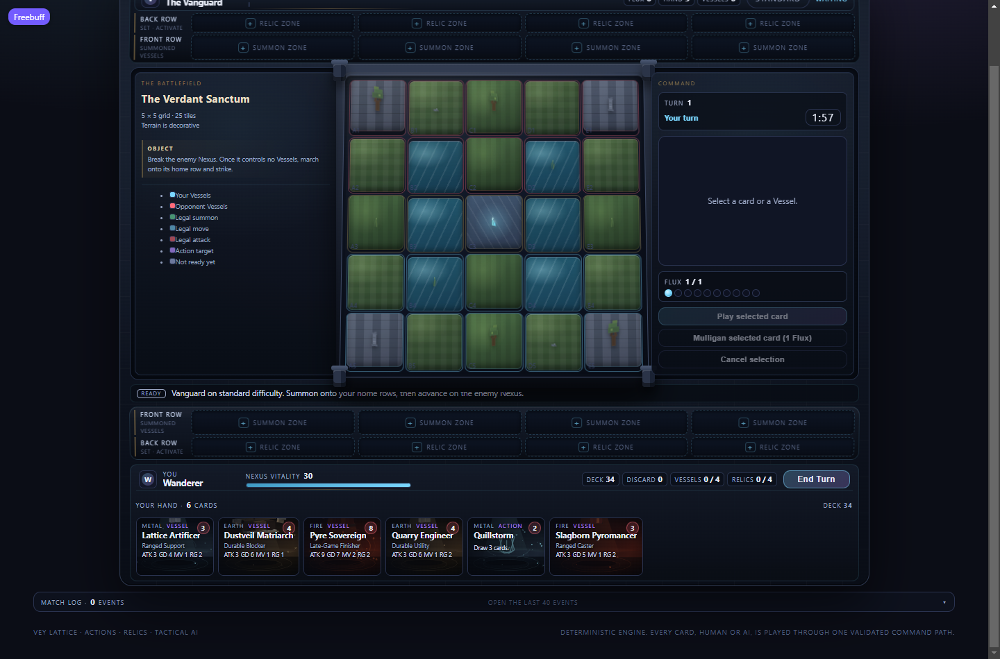

</div>

> **Limitation, stated plainly:** the playable world is CSS-3D. Voxels are real boxes with real depth,
> per-face shading and a perspective camera, but there is no GPU lighting pass or shadow map — shadows
> are painted contact shadows, not cast ones. A WebGL renderer is the next step if that becomes a
> requirement; it is not in this build.


---

## ▸ Screenshots

<div align="center">

**A live match on the war table.** Opponent field above, the 5×5 diorama in the middle, your field and
hand below. Vessel zones show the real model, live Guard and stats; the back row holds set Relics.


</div>

| Summoning: four Vessel zones and ten legal tiles light up | Setting a Relic: the next free Action socket |
|---|---|
| 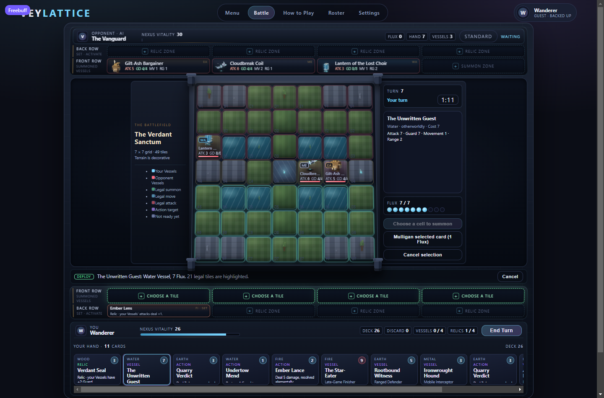 | 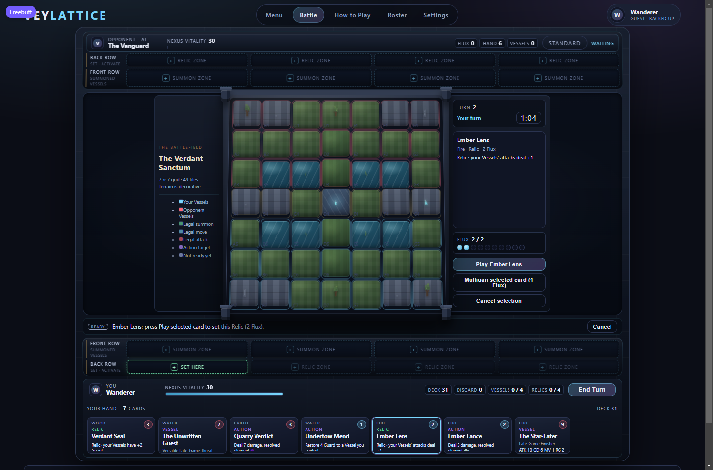 |

| 1024×768 | Mobile (390 px) |
|---|---|
| 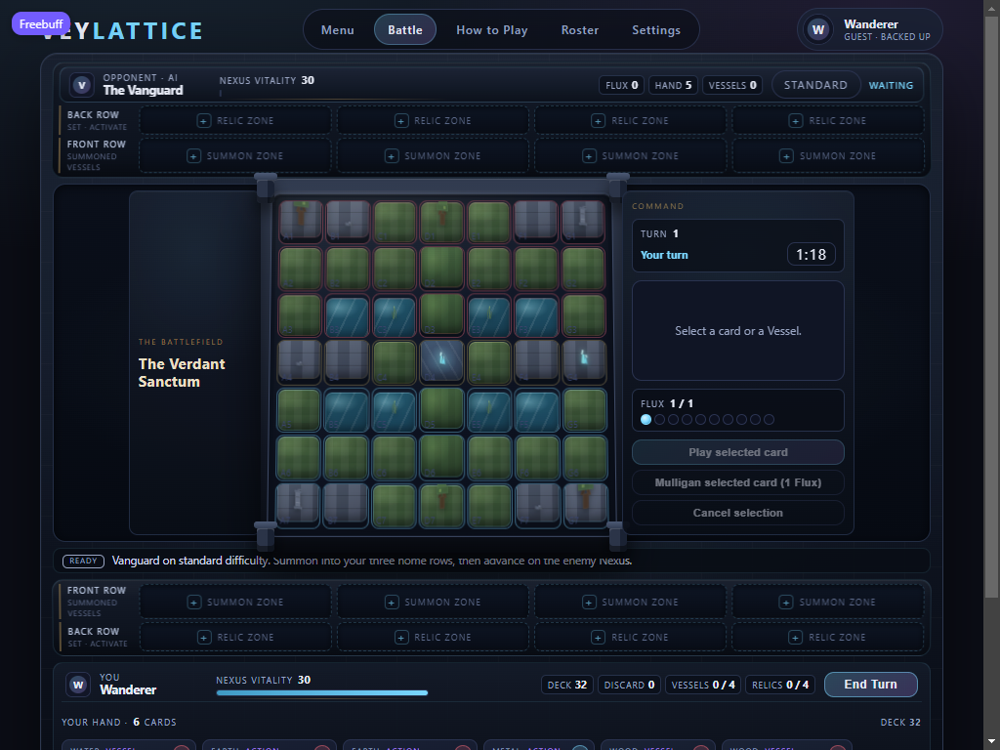 | 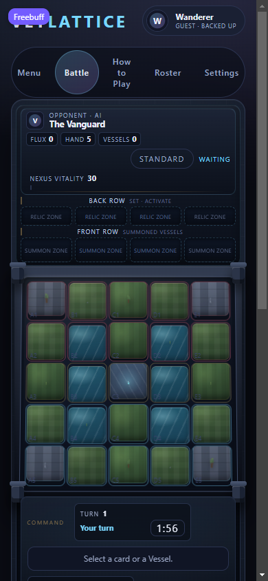 |

<div align="center">

**Menu · roster · guided rules**


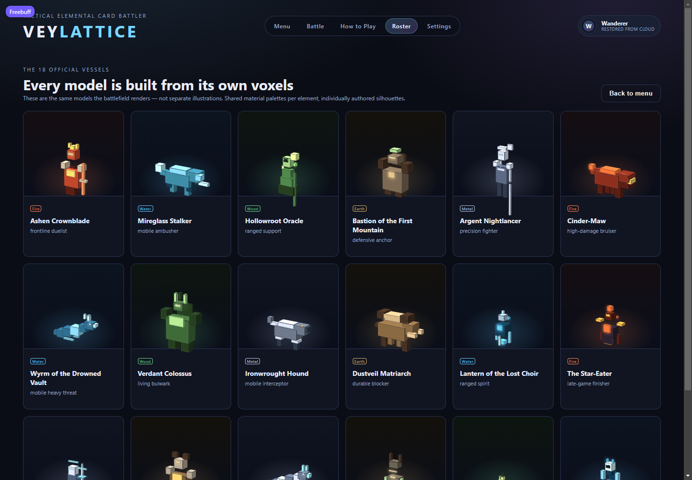


</div>

---

## ▸ Architecture

```
src/game/            DOM-free rules and AI
  constants.js         rule numbers (single source of truth)
  elemental-rules.js   25-pair counter-cycle maths
  content.js           catalog validation, frozen card data, deck legality
  engine.js            deterministic command reducer (applyCommand)
  ai.js                observation → candidates → bounded scoring
src/net/             browser persistence
  config.js            public Supabase URL + publishable key
  rpc.js               one guarded PostgREST transport
  profile.js           sanitise, local-first save, cloud sync, avatar pipeline
  account.js           recovery-code accounts (create, load, save, rotate)
src/render/          presentation-only model layer
  models.js            60 Vessel voxel definitions + element palettes
  voxel.js             CSS-3D model builder (no dependencies)
src/ui/              UI state machines that are worth testing on their own
  tutorial.js          guided-match steps and the pure advance reducer
src/main.js          HUD controller + presentation layer (events → animation)
src/cards/           set manifest + three validated card sets (102 cards)
index.html           Menu, How to Play, Roster, Battle and Settings views
styles.css           themed UI, voxel models, board zones, combat keyframes, reduced motion
tests/               Node test runner, 122 tests, zero dependencies
supabase/migrations/ profile + account schemas and RPCs
docs/                rules, research, adaptation matrix, accounts, session log
```

Design rules the code follows:

1. **The engine never imports the DOM**, and the AI never imports the engine's state — it consumes a
   filtered observation.
2. **Content is data.** Card definitions are validated, deep-frozen, and can never become executable
   code.
3. **Rejected commands are inert.** A failed command returns the original state object; a stale
   `expectedVersion` is rejected; deadline handling materialises a timeout without duplicating
   accepted actions.
4. **Injected clock and RNG.** Determinism is testable because time and randomness are parameters.

---

## ▸ Run locally

```bash
# serve (any static server works)
python -m http.server 8000
# → http://localhost:8000

# tests
npm test            # node --test "tests/*.test.js"
```

### Tests

`npm test` → **122 passing, 0 failing** (~0.9 s). Coverage includes:

| Area | Examples |
|---|---|
| Elemental system | all 25 pairs, rounding, minimum 1, persistent Guard |
| Combat | lethal trades, out-of-range retaliation, blocked line of sight, Nexus gating |
| Actions & Relics | elemental damage, heal capping, permanent buffs, sweeps, Nexus burn vs armour, wrong-side and missing targets, Relic cap, attack/guard/mend auras, aura timing on existing and future Vessels |
| Deck rules | canonical five-Action minimum enforced, vessel-only decks rejected, practice deck legal with no exception profile |
| Content | 102-card pool validates through the set manifest; 60 Vessels split 12 per element; 30 Actions and 12 Relics; every effect kind is used by a shipped card; malformed effects, cross-scope effects, wrong targeting, unknown keywords and pseudo-targeting Relics are rejected |
| Economy & turns | Flux 1→10, zero-Flux restriction, summon limits, draw, fatigue |
| Determinism | byte-identical rejection, seeded replay, catalog immutability |
| Deadlines | boundary rejection, committed actions preserved |
| AI | information isolation, hidden-hand invariance, time budget, legality, tier differentiation, Actions/Relics played through the engine, no pointless casts, full AI-vs-AI match |
| Profiles | name/avatar/settings/stats sanitisation, forged ids, streak maths |
| Voxel roster | all 60 official ids modelled, 12 per element, no shared silhouettes, palette keys resolve, missing model reports `null`, board is 25 tiles split 10/5/10 across the zones |
| Keywords & expansion effects | stun consumes exactly one activation, ready refreshes an acted Vessel, revive returns the highest-cost Vessel, Flux gain caps at `maxFlux`, drain returns half damage, Nexus heal caps at 30, ward never nullifies Action damage, swift and stalwart change summons, deathrattle draws for its controller |
| Card fields | four Vessel + four Action zones per seat, stable unique slot keys, engine-assigned zones survive movement, inserted units fill one slot each, Relics fill the back row in order and the cap equals the slot count |
| Guided match | step order, unrelated events ignored, `endTurn` always escapes, completion clamps, skip is idempotent, every step watches a real engine event |

Tests I did **not** run are listed as unrun in [docs/IMPLEMENTATION_LOG.md](docs/IMPLEMENTATION_LOG.md),
not as passes.

---

## ▸ Deployment

**GitHub Pages** (this is how the live site is served):

1. Repository → **Settings → Pages**.
2. Source: **Deploy from a branch** → `main` → `/ (root)`.
3. `.nojekyll` is committed so the static files are served verbatim.

The site lives at `xiondigital.net/veylattice/` because the account's user site
(`xiondigital.github.io`) already owns the `xiondigital.net` custom domain; GitHub Pages serves
project repositories as subpaths of that domain. **No DNS record, custom-domain setting, or file on
the base site was modified** — `/sohbet` and the root site are unaffected.

**Database** (optional for local play; required for cloud profiles):

1. Create a Supabase project (a separate one — do not reuse another app's project).
2. Run [`supabase/migrations/0001_profiles.sql`](supabase/migrations/0001_profiles.sql) and
   [`supabase/migrations/0002_accounts.sql`](supabase/migrations/0002_accounts.sql) in the SQL editor.
3. Put the project URL and **publishable/anon** key in [`src/net/config.js`](src/net/config.js).
4. Never put the `service_role` key in this repository or in the browser bundle.

Without step 1–3 the game still runs: `CLOUD_ENABLED = false` (or a failing network) degrades to a
clearly labelled local profile and accounts report that cloud sync is disabled.

---

## ▸ Roadmap

| Milestone | State |
|---|---|
| **M1** deterministic engine, HUD, tests, deadline | ✅ done |
| **M2-001** typed Action and Relic effects, relic auras | ✅ done |
| **M2-002** canonical deck rules, practice exception removed | ✅ done |
| **M2-003** tactical AI, difficulties, styles | ✅ done |
| **M2-006** portable accounts, recovery codes, cross-device restore | ✅ done |
| **M2-007** voxel combat presentation | ✅ done |
| **M2-008 / UX-001** menu, How to Play, guided first match, un-auto-launched boot | ✅ done |
| **M2-009** unique voxel models and the roster page | ✅ done |
| **CONTENT-001** 60 Vessels, 30 Actions, 12 Relics, keyword vocabulary, manifest pipeline | ✅ done |
| **M3** collection, deck builder, shop, packs | next |
| **M4** trusted backend, authoritative matches, throttling | planned |
| **M5** lobbies and Tag | planned |
| **M6–M7** ranked, arenas, Lore Bonds, full voxel models | planned |

Full task list, acceptance criteria and blockers: [TODO.md](TODO.md). Dated session records:
[docs/IMPLEMENTATION_LOG.md](docs/IMPLEMENTATION_LOG.md).

---

## ▸ Documentation

- [Canonical rules](GAME_RULES.md) · [technical architecture](TECHNICAL_ARCHITECTURE.md) · [roadmap](ROADMAP.md)
- [Reference research](docs/REFERENCE_RESEARCH.md) · [mechanic adaptation matrix](docs/MECHANIC_ADAPTATION_MATRIX.md)
- [Elemental system](docs/ELEMENTAL_SYSTEM.md) · [combat rules](docs/COMBAT_RULES.md) · [testing guide](docs/TESTING.md)
- [AI handoff](AI_HANDOFF.md) · [changelog](CHANGELOG.md) · [implementation log](docs/IMPLEMENTATION_LOG.md)
- Art and world: [voxel art bible](docs/VOXEL_ART_BIBLE.md), [unit designs](docs/UNIT_VISUAL_DESIGNS.md), [world](docs/WORLD_BIBLE.md), [arenas](docs/ARENA_SYSTEM.md)

---

## ▸ Originality and licensing

Original code, creatures, card text, lore, naming and presentation. Reference games were studied for
*design problems and solutions only* — no assets, card text, UI or code were copied, and the
reference installations were treated as read-only research sources. See
[docs/REFERENCE_RESEARCH.md](docs/REFERENCE_RESEARCH.md) for evidence and documented tool
limitations.

The existing [LICENSE](LICENSE) remains **All Rights Reserved** unless separately authorized.
Third-party dependencies retain their licences; there are currently no runtime dependencies.
